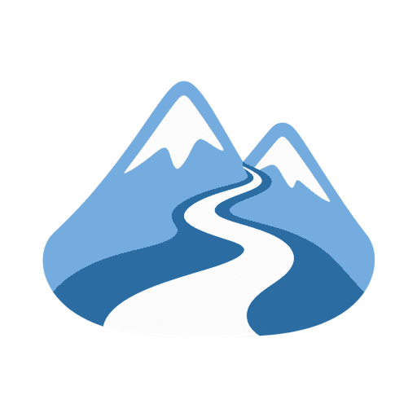

<h1 align="center">Senderos Argentina</h1>

<p align="center">
  
</p>

**Integrantes:** Federico Busum Fradera y Matías Galván

---

## Cómo levantar el proyecto en local

### Requisitos previos
* Flutter SDK con Dart 3.13 o superior. Con `flutter doctor` se puede revisar que esté todo bien instalado.
* Android Studio (o VS Code con la extensión de Flutter) y el Android SDK.
* Un emulador o un celular con Android. Para probar el seguimiento con GPS, los pasos y la brújula conviene un celular real.
* Git para clonar el repositorio.

### Pasos de ejecución
1. **Clonar el repositorio:**
   ```bash
   git clone https://github.com/fedebf03/SenderosArgentina-Flutter.git
   ```

2. **Bajar las dependencias:**
   ```bash
   flutter pub get
   ```

3. **Correr la app:** con el emulador abierto o el celular conectado:
   ```bash
   flutter run
   ```
   También se puede abrir la carpeta con Android Studio, elegir el dispositivo y tocar Run.

---

## Enfoque y decisiones técnicas

**Senderos Argentina** es una app de senderismo hecha con Flutter. Permite crear senderos con su trazado en el mapa, publicarlos para que los vean otros usuarios, explorar los senderos de todos y seguirlos caminando con GPS, contando los pasos y mostrando el rumbo con la brújula.

### Tecnologías utilizadas
* **Lenguaje y UI:** Dart, Flutter y Material 3 (con modo claro, oscuro o el del sistema).
* **Arquitectura:** Clean Architecture separada en capas (`domain`, `data` y `presentation`), con las pantallas como `StatefulWidget`.
* **Backend:** Firebase Authentication (correo y clave, y Google) y Cloud Firestore. Las fotos se suben a Cloudinary con `http`.
* **Mapas:** MapLibre (`maplibre_gl`) con el estilo gratuito de OpenFreeMap.
* **Preferencias:** SharedPreferences para guardar el modo del tema.
* **Notificaciones:** `flutter_local_notifications`, con un servicio en primer plano mientras dura el recorrido.
* **Hardware:** GPS (`geolocator`), acelerómetro y magnetómetro (`sensors_plus`) y cámara (`image_picker`).

### Elección de la arquitectura
Organizamos el código con Clean Architecture, dividido en tres capas. La regla principal es que las pantallas solo conocen el dominio y nunca usan directamente Firestore, Firebase Auth ni los plugins del celular.

El dominio (`lib/domain`) es Dart puro, sin nada de Flutter. Ahí están los modelos y las interfaces de los repositorios (clases abstractas). Las implementaciones están en `lib/data`, que es la única capa que habla con Firebase, Cloudinary, el GPS o los sensores.

Los repositorios se crean una sola vez en `main.dart` y se pasan a las pantallas por el constructor. Así cada pantalla recibe la interfaz y no sabe qué implementación hay detrás.

Las listas de senderos y la sesión del usuario se manejan con `Stream`: cuando algo cambia en Firestore o se inicia o cierra sesión, la pantalla se actualiza sola con un `StreamBuilder`, sin tener que navegar a mano.

### Estructura del proyecto
* `lib/main.dart`: inicia Firebase, lee el tema guardado, crea los repositorios y decide si mostrar el login o el inicio según la sesión.
* `lib/domain/model/`: modelos (sendero, punto, perfil, usuario y preferencias).
* `lib/domain/repository/`: interfaces de los repositorios.
* `lib/data/repository/`: implementaciones con Firebase, Cloudinary, Geolocator, sensores, SharedPreferences y notificaciones locales.
* `lib/presentation/auth/`: inicio de sesión, registro y recuperación de contraseña.
* `lib/presentation/inicio/`: pantalla principal con la barra de navegación (Explorar y Perfil).
* `lib/presentation/explorar/`: Explorar, detalle del sendero y el mapa del trazado.
* `lib/presentation/editar_sendero/`: formulario para crear y editar senderos.
* `lib/presentation/recorrido/`: pantalla del seguimiento mientras se camina.
* `lib/presentation/perfil/`: perfil, edición del perfil y preferencias.
* `lib/presentation/tema.dart`: colores y tema claro y oscuro.

### Funcionalidades principales
* **Autenticación:** Registro e inicio de sesión con correo y clave o con Google. Recuperación de contraseña con un enlace por correo.
* **Explorar:** Muestra los senderos públicos de todos los usuarios y los propios. Se pueden buscar por nombre o región, filtrar por dificultad, ver solo los propios y ordenar por cercanía según la ubicación del usuario.
* **Detalle del sendero:** Datos técnicos, foto, mapa del trazado, dificultad, desnivel, duración estimada, punto de inicio y mejor época. Si el sendero es propio, desde ahí se puede publicar, dejar de publicar, editar o eliminar (con confirmación).
* **Crear y editar senderos:** Formulario con validaciones. El trazado se arma tocando el mapa y la distancia se recalcula con cada punto, que se puede deshacer. El inicio se guarda con la ubicación actual y la foto se saca con la cámara o se elige de la galería.
* **Seguimiento del recorrido:** Con GPS se muestra la posición en el mapa, lo recorrido, lo que falta, los pasos (con el acelerómetro) y el rumbo (con la brújula). Si el celular no tiene alguno de los sensores, ese dato aparece como no disponible.
* **Notificación del recorrido:** Mientras se camina queda una notificación fija con el tiempo, los kilómetros y los pasos. Como es un servicio en primer plano, el GPS sigue funcionando con la pantalla apagada o la app minimizada.
* **Perfil:** Muestra la cuenta y permite editar el nombre, país, provincia y localidad. También tiene la preferencia del tema (sistema, claro u oscuro), que queda guardada para la próxima vez que se abre la app, y el cierre de sesión.

### Datos en Firestore
Cada usuario tiene sus datos en `usuarios/{idUsuario}`, con su perfil y sus senderos. Al publicar un sendero, se copia entero a la colección `senderosPublicos` con el mismo id y el nombre del autor, para que Explorar los pueda leer todos juntos.

Al eliminar un sendero, queda marcado como eliminado en lugar de borrarse, y si estaba publicado se saca de los públicos.

### Seguridad
Las reglas de Firestore (`firestore.rules`) separan los datos de cada usuario: cada uno solo puede leer y escribir lo que está dentro de su propio documento. Los senderos públicos los puede leer cualquier usuario con sesión iniciada, pero solo su autor los puede crear, editar o borrar. Cualquier otra ruta está bloqueada.

Las fotos se suben a Cloudinary con un preset sin firma, así la app no tiene que guardar ninguna clave secreta. En Firestore solo queda la URL de la foto.

### Permisos
* **Ubicación precisa:** para el seguimiento, para guardar el inicio del sendero y para ordenar por cercanía.
* **Notificaciones (Android 13 o superior):** para la notificación del recorrido en curso.
* **Servicio en primer plano de ubicación:** para que el seguimiento siga con la pantalla apagada o con la app minimizada.
* La cámara y la galería se abren con el selector del sistema, por eso no hace falta pedir su permiso.
